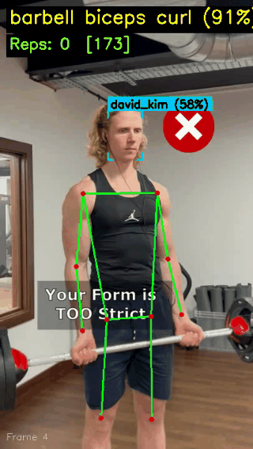
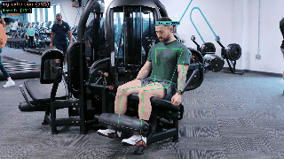
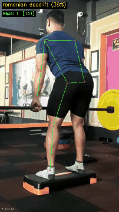

# Smart Gym Monitoring

A computer vision pipeline that processes workout videos to **identify people**, **classify exercises**, **count repetitions**, and produce structured analysis results. Built with MediaPipe pose estimation, InsightFace recognition, and scikit-learn classification.

## Demo

<table>
  <tr>
    <td align="center"><b>Chest Fly Machine</b><br></td>
    <td align="center"><b>Barbell Biceps Curl</b><br></td>
    <td align="center"><b>Bench Press</b><br></td>
  </tr>
  <tr>
    <td align="center"><b>Leg Extension</b><br></td>
    <td align="center"><b>Romanian Deadlift</b><br></td>
    <td align="center"><b>Pull Up</b><br></td>
  </tr>
  <tr>
    <td align="center"><b>Romanian Deadlift 2</b><br></td>
  </tr>
</table>

> Face identification with corner-bracket overlay, skeleton drawing, exercise classification with confidence, and real-time rep counting.

## Pipeline Overview

```
Video Input
  │
  ├──▶ InsightFace Detection + Recognition (first 60 frames)
  │         │
  │         ▼
  │    Embedding Gallery Matching → identified user (cosine similarity)
  │
  ├──▶ MediaPipe Multi-Pose Detection (up to 3 people)
  │      selects best person by body size (60%) + center proximity (40%)
  │         │
  │         ▼
  │    33 Pose Landmarks → 132 Raw Features (x, y, z, visibility)
  │         │
  │         ├──▶ ExtraTrees Classifier → per-frame exercise prediction
  │         │         │
  │         │         ▼
  │         │    EMA + Hysteresis + Min-Hold Stabilizer → stable exercise label
  │         │
  │         ├──▶ Joint Angle Computation (exercise-specific body joints)
  │         │         │
  │         │         ▼
  │         │    Peak-Valley Rep Counter → rep count per exercise
  │         │
  │         ▼
  │    Annotated Video (skeleton + face box + label + rep count)
  │
  ▼
Structured JSON Output
```

## How Each Stage Works

### 1. Face Identification (Embedding-Based)

Uses **InsightFace** (buffalo_l model) for closed-set face recognition. The system works in two phases:

**Enrollment**: Face images of known users are processed to extract 512-dimensional embeddings using InsightFace's pretrained ArcFace model. Multiple images per person are averaged into a single normalized embedding and stored in a gallery file. New users can be enrolled at any time by adding their face images and rebuilding the gallery.

**Recognition**: During video processing, the face detector runs on the first 60 frames. Each detected face is embedded and compared against the gallery using cosine similarity. Votes are accumulated across frames and the identity is locked to the person with the highest average similarity above the threshold (default: 0.4).

This approach requires no model training — it uses a pretrained embedding model and simple nearest-neighbor matching, making it easy to add or remove users from the gallery.

### 2. Pose Estimation & Person Selection

Uses **MediaPipe PoseLandmarker** (heavy variant) in multi-pose mode to detect up to 3 people simultaneously. The best person is selected using a weighted score:

- **Size score (60%)**: Prefers the largest detected body (by bounding box area from visible landmarks)
- **Center score (40%)**: Prefers the person closest to the frame center

### 3. Exercise Classification

The 132 raw landmark features (33 landmarks × 4 values: x, y, z, visibility) are fed directly into a trained **ExtraTrees classifier** (300 trees, max_depth=25, balanced class weights). This approach uses raw normalized coordinates rather than hand-crafted angle features, which proved more robust across camera angles in testing (96% accuracy on holdout set).

### 4. Label Stabilization (EMA + Hysteresis + Min-Hold)

The classifier predicts independently per frame. During an exercise, certain body positions can momentarily resemble a different exercise. Three mechanisms prevent label flickering:

1. **Exponential Moving Average (EMA)**: Smoothed probability score per class using the full `predict_proba` distribution. (alpha=0.15)
2. **Hysteresis margin**: A challenger class must exceed the current label's EMA score by a configurable margin before triggering a switch. (margin=0.15)
3. **Minimum hold time**: After committing to a label, it's locked for N frames before allowing any switch. (15 frames ≈ 500ms at 30fps)
4. **Confidence gate**: Frames where max classifier confidence is below threshold are skipped entirely. (threshold=0.3)

### 5. Rep Counting — Peak-Valley Detection

Counts repetitions by detecting **direction reversals** in the tracked joint angle signal. Unlike fixed-threshold approaches, this works **regardless of camera angle** because it tracks **relative changes**, not absolute values.

```
1. Smooth the raw joint angle with a moving average (window=5)
2. Track whether the angle is currently rising ("up") or falling ("down")
3. When rising: if angle drops >= min_amplitude below the peak → reversal
4. When falling: if angle rises >= min_amplitude above the valley → reversal
5. Every two reversals (peak → valley → peak) = 1 rep
```

Each exercise tracks the biomechanically appropriate joint angle:

| Exercise Group | Joint Tracked | Exercises |
|---|---|---|
| **Legs** | Knee angle | squat, leg extension |
| **Hip hinge** | Hip angle | deadlift, romanian deadlift, hip thrust |
| **Arms (push)** | Elbow angle | bench press, shoulder press, push up, tricep pushdown, tricep dips |
| **Arms (pull)** | Elbow angle | barbell biceps curl, hammer curl, lat pulldown, pull up, t bar row |
| **Shoulders** | Shoulder abduction | lateral raises, chest fly machine |
| **Twist** | Wrist horizontal offset | russian twist |
| **Hold** | Duration (seconds) | plank |

### 6. Output

Each video produces:
- **Annotated video**: Skeleton overlay, face box with corner brackets and identified name, exercise label with confidence, rep count
- **JSON result**: Structured output with identified user, exercise label, rep count, per-rep timestamps, and confidence scores

Sample JSON output:
```json
{
  "video": { "path": "...", "fps": 29.97, "total_frames": 453, "duration_seconds": 15.12 },
  "identification": { "user": "james_carter", "confidence": 0.8658 },
  "exercise": { "label": "chest fly machine", "confidence": 0.9833 },
  "rep_counting": {
    "type": "rep_count",
    "count": 5,
    "reps": [
      { "rep_number": 1, "frame": 44, "timestamp_ms": 1468.1, "angle_at_count": 44.4 },
      { "rep_number": 2, "frame": 141, "timestamp_ms": 4704.7, "angle_at_count": 46.5 }
    ]
  }
}
```

## Model Performance

### Exercise Classification

Trained on the [Kaggle Gym Workout/Exercises Video Dataset](https://www.kaggle.com/datasets/philosopher0808/gym-workoutexercises-video) with 15-frame sampling per video and per-class balancing (max 2,000 samples/class).

| Model | 5-Fold CV Accuracy | Holdout Accuracy |
|---|---|---|
| **ExtraTrees_300** | **96.1%** | **96.9%** |
| RandomForest_300 | 95.5% | — |

### Face Identification

Uses InsightFace's pretrained ArcFace model (buffalo_l). No task-specific training required — embedding similarity matching with a threshold of 0.4.

## Supported Exercises (22 classes)

barbell biceps curl, bench press, chest fly machine, deadlift, decline bench press, hammer curl, hip thrust, incline bench press, lat pulldown, lateral raises, leg extension, leg raises, plank, pull up, push up, romanian deadlift, russian twist, shoulder press, squat, t bar row, tricep dips, tricep pushdown

## Project Structure

```
gym-monitoring/
├── main.py                           # Full pipeline entry point
├── config.yaml                       # All configurable parameters
├── requirements.txt
│
├── scripts/
│   ├── extract_pose_features.py      # Extract landmark features from training videos
│   ├── experiment.py                 # Train & compare classifiers (5-fold CV + holdout)
│   ├── evaluate.py                   # Evaluate model on unseen test videos
│   ├── predict.py                    # Real-time prediction from video/webcam
│   ├── extract_faces.py              # Extract face crops from videos for enrollment
│   └── enroll_faces.py               # Build face embedding gallery
│
├── src/
│   ├── pipeline.py                   # Main pipeline orchestrator
│   ├── face_id/
│   │   ├── enroll.py                 # Face enrollment (images → embedding gallery)
│   │   └── recognize.py              # Face recognition (frame → identity match)
│   ├── pose/
│   │   ├── estimator.py              # MediaPipe multi-pose with best-person selection
│   │   └── angles.py                 # Joint angle computation helpers
│   ├── exercise/
│   │   ├── definitions.py            # Exercise enum definitions
│   │   ├── classifier.py             # Raw landmark classifier wrapper
│   │   └── stabilizer.py             # EMA + hysteresis + min-hold label smoothing
│   ├── rep_counter/
│   │   ├── counter.py                # Peak-valley rep counter + RepCounterManager
│   │   └── rep_rules.py              # Per-exercise joint angles & min_amplitude thresholds
│   ├── output/
│   │   ├── video_annotator.py        # Skeleton + HUD overlay drawing
│   │   └── json_writer.py            # Structured JSON output
│   └── utils/
│       ├── geometry.py               # 3-point angle calculation
│       ├── video_io.py               # OpenCV video read/write helpers
│       └── config.py                 # YAML → typed dataclass config loader
│
├── tests/
│   ├── test_stabilizer.py            # Stabilizer unit tests
│   └── test_rep_counter.py           # Rep counter unit tests
│
├── data/
│   ├── videos/                       # Training + test videos (not in git)
│   ├── models/                       # Model files (not in git)
│   │   ├── pose_landmarker_heavy.task
│   │   └── exercise_classifier.pkl
│   ├── faces/                        # Face enrollment images per person (not in git)
│   │   ├── james_carter/train/
│   │   ├── mike_ross/train/
│   │   └── ...
│   └── gallery.pkl                   # Face embedding gallery (not in git)
│
└── outputs/                          # Annotated videos + JSON results
```

## Setup

```bash
conda create -n gym-monitoring python=3.10 -y
conda activate gym-monitoring
pip install -r requirements.txt
```

Download model files into `data/models/`:
- `pose_landmarker_heavy.task` — from [MediaPipe model catalog](https://developers.google.com/mediapipe/solutions/vision/pose_landmarker#models)

InsightFace's `buffalo_l` model is downloaded automatically on first run.

## Usage

### 1. Enroll faces

Place face images for each person in `data/faces/<person_name>/train/`, then build the embedding gallery:

```bash
python scripts/enroll_faces.py
```

To add a new user, create a new folder with their face images and re-run enrollment.

### 2. Run the full pipeline

```bash
# Process a video → outputs annotated video + JSON result
python main.py "data/videos/test/squat/squat_1.mp4"

# JSON-only (skip annotated video)
python main.py "data/videos/test/squat/squat_1.mp4" --no-annotate

# Custom output directory
python main.py "data/videos/test/squat/squat_1.mp4" --output results/
```

### 3. Real-time prediction (with live display)

```bash
# From a video file
python scripts/predict.py --source "data/videos/test/deadlift/deadlift_1.mp4"

# Live webcam
python scripts/predict.py --source 0

# Save annotated video
python scripts/predict.py --source "data/videos/test/squat/video1.mp4" --save
```

Controls:
- `q` — quit
- `r` — reset stabilizer, rep counter, and face ID

### 4. Train exercise classifier

```bash
# Extract raw landmark features from all training videos
python scripts/extract_pose_features.py --all --output data/landmarks.csv

# Train classifiers and save best model
python scripts/experiment.py --features data/landmarks.csv

# Evaluate on unseen test videos
python scripts/evaluate.py --test-dir data/videos/test
```

### 5. Run tests

```bash
python -m pytest tests/ -v
```

## Configuration

All parameters are in `config.yaml`:

| Section | Setting | Default | Description |
|---|---|---|---|
| **face_id** | `model_name` | `buffalo_l` | InsightFace model for face embedding |
| | `similarity_threshold` | 0.4 | Min cosine similarity for a match |
| | `max_identification_frames` | 60 | Frames used for identity voting |
| **pose** | `model_path` | `pose_landmarker_heavy.task` | MediaPipe pose model |
| | `max_poses` | 3 | Max people to detect per frame |
| | `person_size_weight` | 0.6 | Weight for largest body selection |
| | `person_center_weight` | 0.4 | Weight for center proximity selection |
| **exercise** | `classifier_model_path` | `exercise_classifier.pkl` | Trained sklearn classifier |
| | `stabilizer_ema_alpha` | 0.15 | EMA smoothing (lower = smoother) |
| | `stabilizer_hysteresis_margin` | 0.15 | Margin to switch label |
| | `stabilizer_min_hold_frames` | 15 | Frames before label can switch |
| | `min_classification_score` | 0.3 | Confidence gate threshold |
| **rep_counter** | `min_rep_duration_ms` | 800 | Min time for one full rep (ms) |
| | `angle_smoothing_window` | 5 | Moving average window for angles |

## Training Data

Source: [Kaggle Gym Workout/Exercises Video Dataset](https://www.kaggle.com/datasets/philosopher0808/gym-workoutexercises-video)

- ~1,600 video clips across 22 exercise categories
- Pre-processed clips (10-13 seconds), MP4 format
- 15 frames sampled per video at fixed proportions

## Hardware

Tested on Apple M4 Pro (24GB). MediaPipe and InsightFace run on CPU. Classification is lightweight (sklearn ExtraTrees inference).
