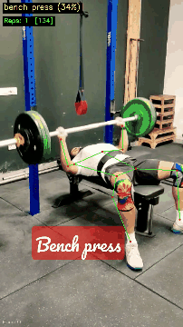
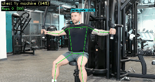
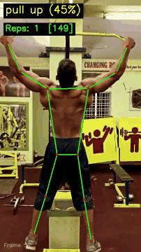

# Smart Gym Monitoring

A computer vision pipeline that processes workout videos to **identify exercises**, **count repetitions**, and produce structured analysis results. Built with MediaPipe pose estimation and scikit-learn classification.

## Demo

<table>
  <tr>
    <td align="center"><b>Bench Press</b><br></td>
    <td align="center"><b>Chest Fly Machine</b><br></td>
  </tr>
  <tr>
    <td align="center"><b>Pull Up</b><br></td>
    <td align="center"><b>Romanian Deadlift</b><br></td>
  </tr>
</table>

> Skeleton overlay, exercise classification with confidence, and real-time rep counting.

## Pipeline Overview

```
Video/Webcam
  │
  ▼
MediaPipe Multi-Pose Detection (up to 3 people)
  │  selects best person by body size (60%) + center proximity (40%)
  ▼
33 Pose Landmarks → 132 Raw Features (x, y, z, visibility)
  │
  ├──▶ ExtraTrees Classifier → per-frame exercise prediction
  │         │
  │         ▼
  │    EMA + Hysteresis + Min-Hold Stabilizer → stable exercise label
  │
  ├──▶ Joint Angle Computation (exercise-specific body joints)
  │         │
  │         ▼
  │    Peak-Valley Rep Counter → rep count per exercise
  │
  ▼
Annotated Output (skeleton + label + rep count overlay)
```

## How Each Stage Works

### 1. Pose Estimation & Person Selection

Uses **MediaPipe PoseLandmarker** (heavy variant) in multi-pose mode to detect up to 3 people simultaneously. The best person is selected using a weighted score:

- **Size score (60%)**: Prefers the largest detected body (by bounding box area from visible landmarks)
- **Center score (40%)**: Prefers the person closest to the frame center

This replaces the earlier YOLO-based person detection, reducing the dependency chain and providing more consistent landmark extraction.

### 2. Exercise Classification

The 132 raw landmark features (33 landmarks × 4 values: x, y, z, visibility) are fed directly into a trained **ExtraTrees classifier** (300 trees, max_depth=25, balanced class weights). This approach uses raw normalized coordinates rather than hand-crafted angle features, which proved more robust across camera angles in testing (96% accuracy on holdout set).

### 3. Label Stabilization (EMA + Hysteresis + Min-Hold)

The classifier predicts independently per frame. During an exercise, certain body positions can momentarily resemble a different exercise (e.g., bottom of a squat looks like a deadlift). Three mechanisms prevent label flickering:

1. **Exponential Moving Average (EMA)**: Maintains a smoothed probability score per class using the full `predict_proba` distribution (not just argmax). Transient spikes are naturally dampened. (alpha=0.15)

2. **Hysteresis margin**: A challenger class must exceed the current label's EMA score by a configurable margin before triggering a switch. Prevents "barely winning" flips. (margin=0.15)

3. **Minimum hold time**: After committing to a label, it's locked for N frames before allowing any switch. Prevents rapid oscillation. (15 frames ≈ 500ms at 30fps)

4. **Confidence gate**: Frames where max classifier confidence is below threshold are skipped entirely. (threshold=0.3)

A genuine exercise transition registers in ~20-30 frames (~0.7-1.0s), which feels natural.

### 4. Rep Counting — Peak-Valley Detection

Counts repetitions by detecting **direction reversals** in the tracked joint angle signal. Unlike fixed-threshold approaches (HIGH/LOW zones), this works **regardless of camera angle** because it tracks **relative changes**, not absolute values.

#### Why Not Fixed Thresholds?

MediaPipe gives 2D projected angles, not true 3D joint angles. The actual observed angle range depends heavily on camera position — a squat filmed from the side shows a different knee angle range than one filmed at 45°. Fixed thresholds (e.g., "knee angle < 90° = bottom of squat") fail because:
- The 2D projected angle at the bottom of a squat varies from 60° to 120° depending on camera angle
- Large dead zones between thresholds cause the angle to never cross either threshold
- Different people have different ranges of motion

#### The Algorithm

```
1. Smooth the raw joint angle with a moving average (window=5)
2. Track whether the angle is currently rising ("up") or falling ("down")
3. When rising: if angle drops >= min_amplitude below the peak → reversal
4. When falling: if angle rises >= min_amplitude above the valley → reversal
5. Every two reversals (peak → valley → peak) = 1 rep
```

The `min_amplitude` parameter (degrees) is the minimum angle change required to confirm a reversal. This prevents noise from triggering false reps while still catching real repetitions regardless of camera angle.

#### Per-Exercise Joint Selection

Each exercise tracks the biomechanically appropriate joint angle:

| Exercise Group | Joint Tracked | Angle At | Exercises |
|---|---|---|---|
| **Legs** | Hip → Knee → Ankle | Knee | squat, leg extension |
| **Hip hinge** | Shoulder → Hip → Knee | Hip | deadlift, romanian deadlift, hip thrust |
| **Leg raises** | Shoulder → Hip → Ankle | Hip flexion | leg raises |
| **Arms (push)** | Shoulder → Elbow → Wrist | Elbow | bench press, decline bench press, incline bench press, shoulder press, push up, tricep pushdown, tricep dips |
| **Arms (pull)** | Shoulder → Elbow → Wrist | Elbow | barbell biceps curl, hammer curl, lat pulldown, pull up, t bar row |
| **Shoulders** | Hip → Shoulder → Wrist | Shoulder abduction | lateral raises |
| **Chest fly** | Hip → Shoulder → Elbow | Shoulder abduction | chest fly machine |
| **Twist** | Wrist horizontal offset / shoulder width | Position-based | russian twist |
| **Hold** | — | Duration (seconds) | plank |

Both left and right sides are tracked and averaged. If only one side is visible, it falls back to that side.

#### Timing Constraints

- **Minimum rep duration**: 800ms between half-reps prevents double-counting from jitter
- **Angle smoothing**: 5-frame moving average filters sensor noise

### 5. Annotated Output

The inference window displays:
- **Pose skeleton**: 12-point body skeleton drawn on the person
- **Exercise label**: Stabilized exercise name with confidence percentage
- **Rep counter**: Current rep count with tracked angle value (or hold duration for plank)
- **Frame counter**: Current frame number

## Model Performance

Trained on the [Kaggle Gym Workout/Exercises Video Dataset](https://www.kaggle.com/datasets/philosopher0808/gym-workoutexercises-video) with 15-frame sampling per video and per-class balancing (max 2,000 samples/class).

| Model | 5-Fold CV Accuracy | Holdout Accuracy |
|---|---|---|
| **ExtraTrees_300** | **96.1%** | **96.9%** |
| RandomForest_300 | 95.5% | — |
| RandomForest_500 | 95.5% | — |

## Supported Exercises (22 classes)

barbell biceps curl, bench press, chest fly machine, deadlift, decline bench press, hammer curl, hip thrust, incline bench press, lat pulldown, lateral raises, leg extension, leg raises, plank, pull up, push up, romanian deadlift, russian twist, shoulder press, squat, t bar row, tricep dips, tricep pushdown

## Project Structure

```
gym-monitoring/
├── main.py                           # Entry point (pipeline orchestrator)
├── config.yaml                       # All configurable parameters
├── requirements.txt
│
├── scripts/
│   ├── extract_pose_features.py      # Extract 132 raw landmark features from training videos
│   ├── experiment.py                 # Train & compare classifiers (5-fold CV + holdout)
│   ├── evaluate.py                   # Evaluate model on unseen test videos
│   └── predict.py                    # Live prediction from video/webcam with rep counting
│
├── src/
│   ├── pipeline.py                   # Main pipeline orchestrator
│   ├── pose/
│   │   ├── estimator.py              # MediaPipe multi-pose with best-person selection
│   │   ├── person_detector.py        # YOLOv8 person detection (legacy, unused)
│   │   └── angles.py                 # Joint angle computation helpers
│   ├── exercise/
│   │   ├── definitions.py            # Exercise enum definitions
│   │   ├── classifier.py             # Raw landmark classifier wrapper
│   │   └── stabilizer.py             # EMA + hysteresis + min-hold label smoothing
│   ├── rep_counter/
│   │   ├── counter.py                # Peak-valley rep counter + RepCounterManager
│   │   └── rep_rules.py              # Per-exercise joint angles & min_amplitude thresholds
│   ├── output/
│   │   ├── video_annotator.py        # Skeleton + HUD overlay drawing
│   │   └── json_writer.py            # Structured JSON output
│   └── utils/
│       ├── geometry.py               # 3-point angle calculation, torso inclination
│       ├── video_io.py               # OpenCV video read/write helpers
│       └── config.py                 # YAML → typed dataclass config loader
│
├── tests/
│   ├── test_stabilizer.py            # Stabilizer unit tests
│   └── test_rep_counter.py           # Rep counter unit tests (24 tests)
│
├── data/
│   ├── videos/                       # Training + test videos (not in git)
│   ├── models/                       # Model files (not in git)
│   │   ├── pose_landmarker_heavy.task
│   │   └── exercise_classifier.pkl
│   └── landmarks.csv                 # Extracted landmark features (not in git)
│
└── outputs/                          # Saved annotated videos (from --save)
```

## Setup

```bash
conda create -n gym-monitoring python=3.10 -y
conda activate gym-monitoring
pip install -r requirements.txt
```

Download model files into `data/models/`:
- `pose_landmarker_heavy.task` — from [MediaPipe model catalog](https://developers.google.com/mediapipe/solutions/vision/pose_landmarker#models)

## Usage

### Train a model

```bash
# 1. Extract raw landmark features from all training videos
python scripts/extract_pose_features.py --all --output data/landmarks.csv

# 2. Train classifiers and save best model
python scripts/experiment.py --features data/landmarks.csv

# 3. Evaluate on unseen test videos
python scripts/evaluate.py --test-dir data/videos/test
```

### Run inference

```bash
# From a video file
python scripts/predict.py --source "data/videos/test/deadlift/deadlift_1.mp4"

# Live webcam
python scripts/predict.py --source 0

# Save annotated video to outputs/
python scripts/predict.py --source "data/videos/test/squat/video1.mp4" --save
```

Controls:
- `q` — quit
- `r` — reset stabilizer and rep counter

### Run tests

```bash
python -m pytest tests/ -v
```

## Configuration

All parameters are in `config.yaml`:

| Section | Setting | Default | Description |
|---|---|---|---|
| **pose** | `model_path` | `pose_landmarker_heavy.task` | MediaPipe pose model |
| | `max_poses` | 3 | Max people to detect per frame |
| | `person_size_weight` | 0.6 | Weight for largest body selection |
| | `person_center_weight` | 0.4 | Weight for center proximity selection |
| **exercise** | `classifier_model_path` | `exercise_classifier.pkl` | Trained sklearn classifier |
| | `stabilizer_ema_alpha` | 0.15 | EMA smoothing (lower = smoother) |
| | `stabilizer_hysteresis_margin` | 0.15 | Margin to switch label |
| | `stabilizer_min_hold_frames` | 15 | Frames before label can switch |
| | `min_classification_score` | 0.3 | Confidence gate threshold |
| **rep_counter** | `min_rep_duration_ms` | 800 | Min time for one full rep (ms) |
| | `angle_smoothing_window` | 5 | Moving average window for angles |

## Training Data

Source: [Kaggle Gym Workout/Exercises Video Dataset](https://www.kaggle.com/datasets/philosopher0808/gym-workoutexercises-video)

- ~1,600 video clips across 22 exercise categories
- Pre-processed clips (10-13 seconds), MP4 format
- 15 frames sampled per video at fixed proportions (10%, 15%, 20%, ..., 95% of total frames)

## Hardware

Tested on Apple M4 Pro (24GB). MediaPipe runs on CPU. Classification is lightweight (sklearn ExtraTrees inference).
